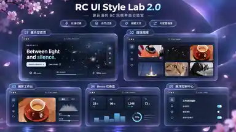

# RC UI Style Skill 2.0

RedialC 的个人 UI 风格技能包：轻磨砂、分级圆角矩形、细描边、紧凑对齐，并融合 [Kiseki](https://kiseki.blog/) 的氛围、导航、卡片与内容动效模式。

这是可复制到不同 Agent 工作流的文件型 Skill。2.0 保留现有视觉体系，增加文案简洁性与动效连续性要求。历史确认图保留在 [style-confirmation.png](skills/rc-ui-style/assets/style-confirmation.png)；其文字和数值不作为精确规格。

## 2.0 参考图

图像为压缩构图预览。参考布局、玻璃分层、导航与卡片组合；不以图片中的文字、数据或动画表述作为产品要求。实际界面文案遵循 [2.0 文案规范](skills/rc-ui-style/references/content-style.md)，动画遵循 [2.0 连续性规范](skills/rc-ui-style/references/motion-v2.md)。

## 使用

完整复制 `skills/rc-ui-style/`，保留内部相对路径，放到目标 Agent 支持的技能目录。支持项目级 Codex skills 的环境可放入项目的 `.agents/skills/rc-ui-style/`；其他客户端按各自说明选择目录。复制文件不代表目标客户端已经加载成功，请在目标环境确认。

可直接对支持显式 skill 调用的 Agent 说：

> 使用 $rc-ui-style 改善当前界面，保留业务功能和既有主题。先说明采用的组件与动效规则，再实现并验收。

不支持自动发现 skills 的 Agent，可让它先阅读 `skills/rc-ui-style/SKILL.md`。本仓库本身不向个人技能目录安装任何东西。

## 选择表现强度

2026-10-31 的 Kiseki 融合扩展了可选择的效果，不替换原有六个项目归纳出的基础语言。先按界面用途选择强度，再为每项效果确定用途与降级：

| 强度 | 常见用途 | 选择原则 |
|---|---|---|
| `restrained` | 编辑器、设置、桌面工具 | 短反馈、清晰状态、紧凑布局，默认不加持续装饰 |
| `expressive` | 图库、内容页、仪表盘 | 选择局部光晕、导航岛、Bento、内容过渡等适用机制 |
| `showcase` | 主页、作品入口 | 可加强环境与编排，内容仍立即可用，动效可关闭 |

材质 `glass / solid / outline / flat` 与浅深主题分别选择。光标聚光、局部视差等属于渐进增强；触摸、键盘、减少动效和低性能路径必须保持完整功能。原有组件页用于查看基础状态，新增效果页用于查看可选增强，不要求将整页示例移植到产品。

## 内容

- `SKILL.md`：工作入口、风格原则与引用路由。
- `references/visual-system.md`：配色、材质、圆角、密度与排版。
- `references/components.md`：按钮、导航、输入、卡片、状态与布局细节。
- `references/motion.md`：基础动效节奏与项目例外。
- `references/motion-v2.md`：2.0 场景连续性、中断、状态与性能验收。
- `references/content-style.md`：2.0 UI 文案写法、禁止项及验收。
- `references/acceptance.md`：视觉、交互、响应式及可访问性验收，含独立子线程分模块评分、证据覆盖率、阻断规则和复验模板。
- `references/source-map.md`：六个原有参考项目的固定版本证据，以及 Kiseki 的来源边界与例外。
- `references/kiseki-effects.md`：Kiseki 效果目录、证据等级、适用场景与融合矩阵。
- `references/effects-recipes.md`：增强效果的实现配方、接口、生命周期与降级约定。
- `assets/rc-ui.css`：可选、局部作用域的 CSS 起始模板。
- `assets/components.html`：无需依赖的组件状态示例，直接用浏览器打开。
- `assets/rc-effects.css`、`assets/rc-effects.js`：显式启用的增强效果；接入方式见实现配方。
- `assets/effects.html`：增强效果交互示例，配合基础资产直接使用。
- `assets/style-confirmation.png`：历史风格确认图。
- `assets/style-reference-v2.webp`：2.0 构图参考压缩预览；不作为文案或像素级验收依据。

## 边界

不把所有控件改成胶囊，不锁死蓝色，不让玻璃压过可读性，不把教学示例当产品规范。小型悬浮工具、大型仪表盘和媒体图库保留各自密度与圆角差异。装饰氛围与业务忙碌状态分开；减少动效、隐藏页暂停、触摸与低性能回退是实现的一部分。图片、视频及其他作品本体保持真实色彩，不随主题或氛围统一滤色。

本包不包含第三方项目源码复制、字体或图标依赖；来源链接用于追溯。未指定开源许可证，不据此授予其他参考项目的许可。
